# GitDiagram architecture — @konitif/temporal

This architecture view was generated from the public repository by [GitDiagram](https://gitdiagram.com/lemouf/konitif-temporal) on 2026-09-20 18:45:23 UTC.

It is a documentation projection of the repository tree, README, and source files sampled by GitDiagram. It does not replace the authored contracts in [catalog.json](catalog.json) and [diagrams.json](diagrams.json), nor does it establish runtime authority.

The Mermaid source keeps GitDiagram's groups, nodes, relationships, and source links. GitDiagram's forced color classes and HTML line breaks are omitted so the diagram remains readable in local previews and dark themes.

- Public repository: [konitif-temporal](https://github.com/LeMouf/konitif-temporal)
- Interactive diagram: [Open in GitDiagram](https://gitdiagram.com/lemouf/konitif-temporal)

## Architecture diagram

```mermaid
flowchart TD

subgraph group_clocking["Clocking"]
  node_root_clock["Root Clock — [rootClock.ts]"]
  node_fixed_clock["Fixed-Step Clock — [fixedStepClock.ts]"]
  node_audio_clock["Audio Clock — [audioClock.ts]"]
  node_video_clock["Video Clock — [videoClock.ts]"]
  node_clock_graph["Clock Graph — [clockGraph.ts]"]
  node_public_api["Public API — [index.ts]"]
end

subgraph group_transport["Transport"]
  node_transport_types["Transport Contracts — [transportTypes.ts]"]
  node_temporal_transport["Temporal Transport"]
end

subgraph group_runtime["Runtime Loop"]
  node_frame_budget["Frame Budget — [frameBudget.ts]"]
  node_invalidation["Invalidation Controller"]
  node_scheduler["Temporal Scheduler"]
end

subgraph group_history["Temporal History"]
  node_history[("History Recorder")]
end

node_application(("Application Runtime"))
node_scheduler_host(("Scheduler Host"))
node_media_sources(("Media Sources"))

node_application -->|"imports APIs"| node_public_api
node_application -->|"creates graph"| node_clock_graph
node_application -->|"creates transport"| node_temporal_transport
node_application -->|"starts scheduler"| node_scheduler
node_application -->|"invalidates state"| node_invalidation
node_application -->|"records history"| node_history
node_application -->|"supplies time"| node_root_clock
node_media_sources -.->|"provides audio time"| node_audio_clock
node_media_sources -.->|"provides video time"| node_video_clock
node_clock_graph -->|"reads adapter"| node_root_clock
node_clock_graph -->|"reads adapter"| node_fixed_clock
node_clock_graph -->|"reads adapter"| node_audio_clock
node_clock_graph -->|"reads adapter"| node_video_clock
node_temporal_transport -->|"reads and converts"| node_clock_graph
node_scheduler -->|"creates budget"| node_frame_budget
node_scheduler -->|"ticks transport"| node_temporal_transport
node_scheduler -->|"checks and consumes"| node_invalidation
node_scheduler -->|"requests frames"| node_scheduler_host
node_scheduler -->|"calls frame work"| node_application

click node_root_clock "https://github.com/lemouf/konitif-temporal/blob/main/src/clock/rootClock.ts"
click node_fixed_clock "https://github.com/lemouf/konitif-temporal/blob/main/src/clock/fixedStepClock.ts"
click node_audio_clock "https://github.com/lemouf/konitif-temporal/blob/main/src/clock/audioClock.ts"
click node_video_clock "https://github.com/lemouf/konitif-temporal/blob/main/src/clock/videoClock.ts"
click node_clock_graph "https://github.com/lemouf/konitif-temporal/blob/main/src/clock/clockGraph.ts"
click node_transport_types "https://github.com/lemouf/konitif-temporal/blob/main/src/transport/transportTypes.ts"
click node_temporal_transport "https://github.com/lemouf/konitif-temporal/blob/main/src/transport/temporalTransport.ts"
click node_frame_budget "https://github.com/lemouf/konitif-temporal/blob/main/src/scheduler/frameBudget.ts"
click node_invalidation "https://github.com/lemouf/konitif-temporal/blob/main/src/invalidation/invalidationController.ts"
click node_scheduler "https://github.com/lemouf/konitif-temporal/blob/main/src/scheduler/temporalSchedulerCore.ts"
click node_history "https://github.com/lemouf/konitif-temporal/blob/main/src/history/temporalHistoryCore.ts"
click node_public_api "https://github.com/lemouf/konitif-temporal/blob/main/src/index.ts"

```

## Generated analysis

@konitif/temporal is a runtime timing library. An application supplies clock providers and creates a clock graph, then a transport advances and converts temporal position. An explicit scheduler drives transport ticks through a caller-owned host, consulting invalidation state before invoking frame work. Applications can independently record immutable samples/events and replay history. Audio and video adapters remain optional integrations. The graph reflects sampled implementations plus README-documented public capabilities; unsampled adapter internals and history wiring are not inferred.
